

[][website]

  

<!-- Websites -->
[website]: https://lotharie.net/

### My projects

    <a href="https://www.lotharie.net/dev/francememes">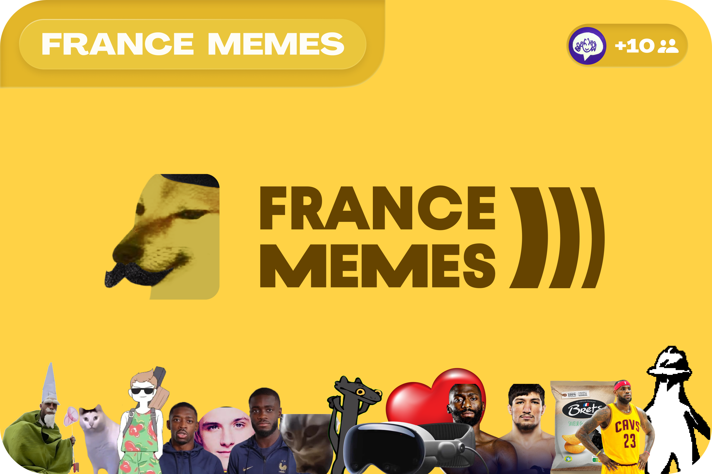</a>
    <a href="">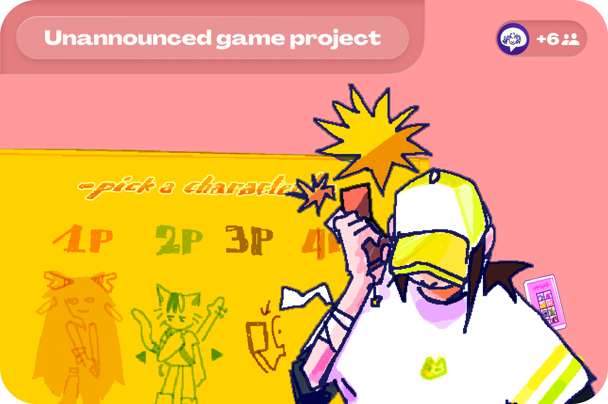</a>
    <a href="https://github.com/LotharieSlayer/telebot">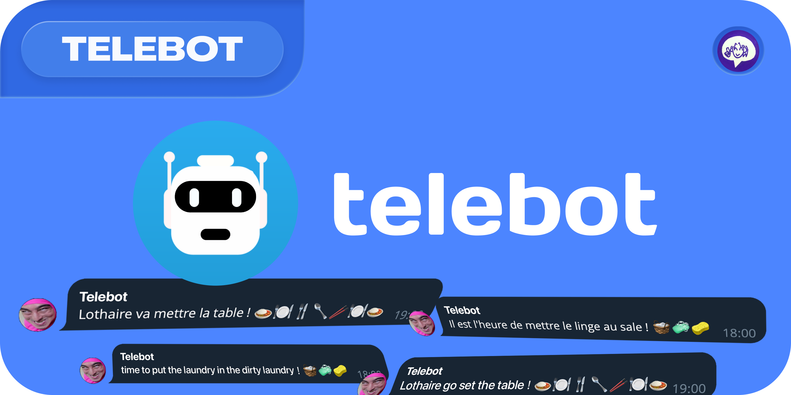</a>
    <a href="https://github.com/LotharieSlayer/OBS-scripts">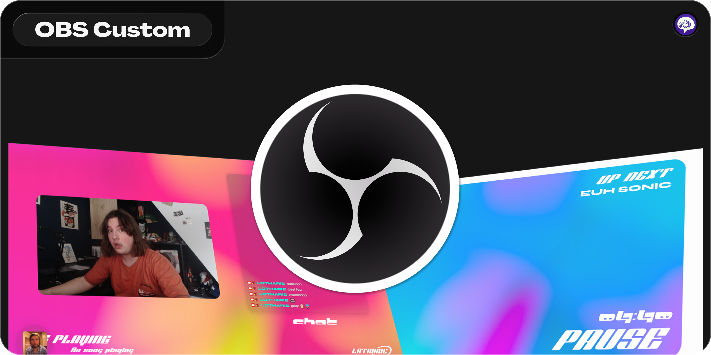</a>
    <a href="https://github.com/LotharieSlayer/wtpbot">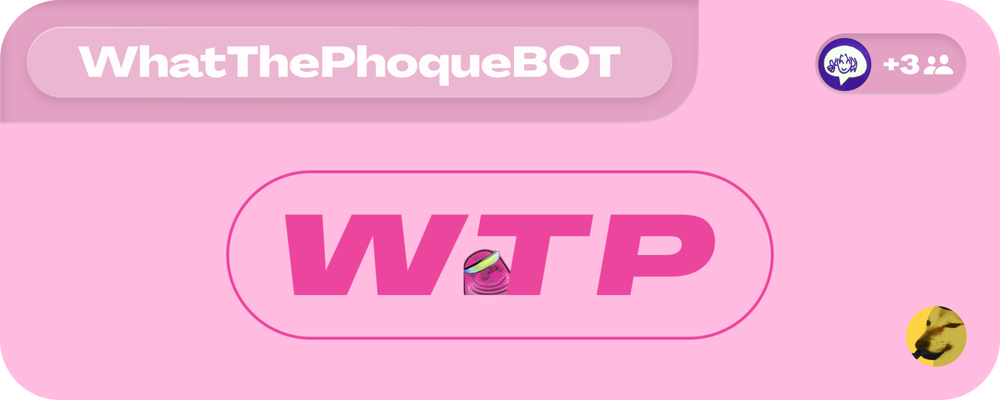</a>
    <a href="https://www.lotharie.net/dev/francememes">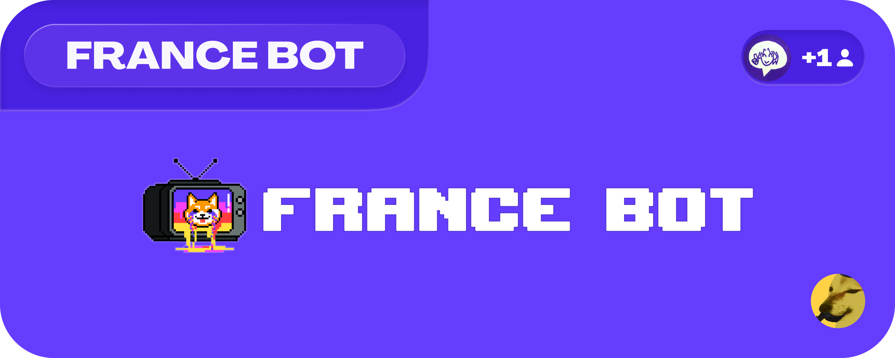</a>
    <a href="https://www.lotharie.net/dev/jetrush">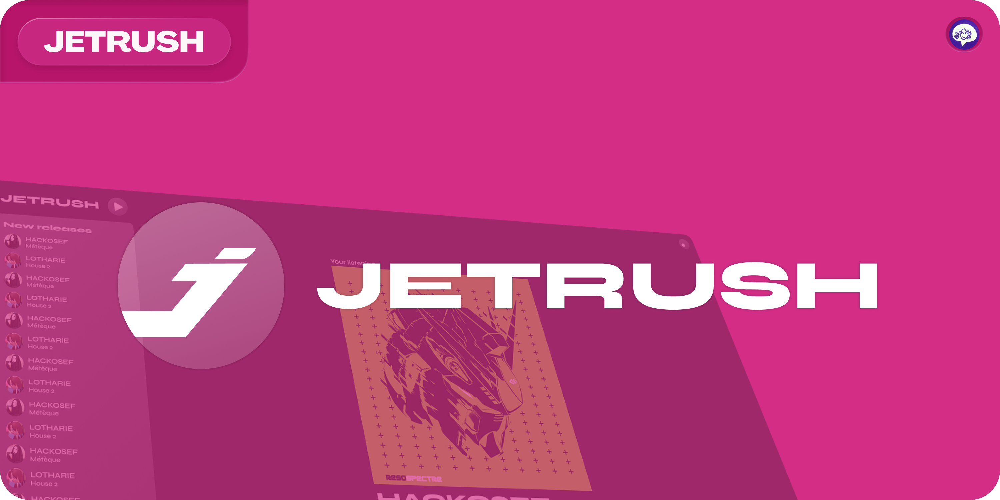</a>
    

### School projects

    
    <a href="https://github.com/LotharieSlayer/tetra">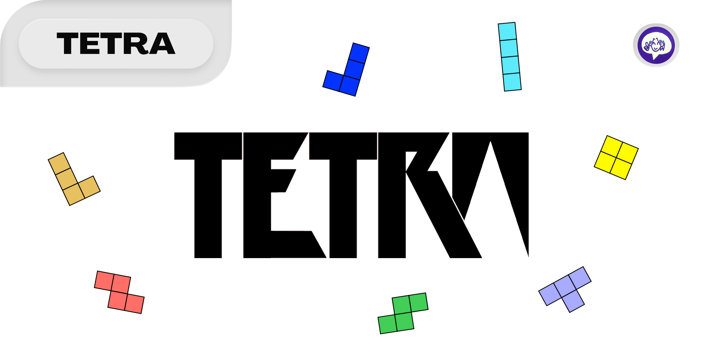</a>
    <a href="https://github.com/uAtomicBoolean/ant-colony">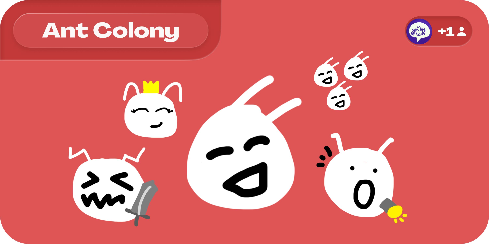</a>
    <a href="https://github.com/LotharieSlayer/S2projetTut">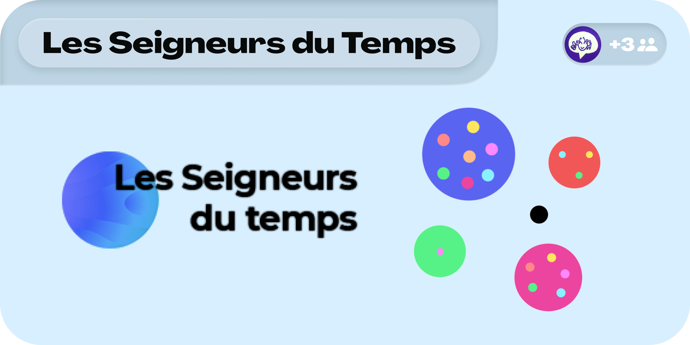</a>
    

### Public companies projects

    <a href="https://play.google.com/store/apps/details?id=com.teicee.DrakkeyTale">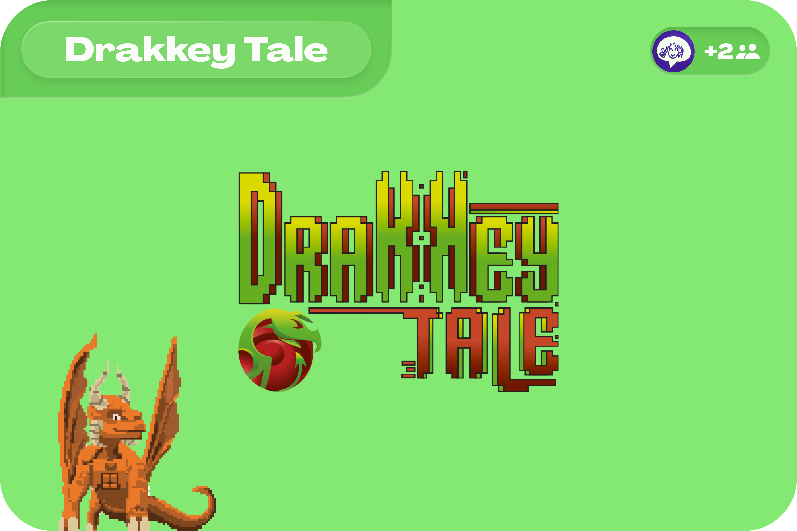</a>
  

  

 

### My stack

<table align="center">
 <thead>
  <tr>
   <th colspan="2"><b>Software Development</b></th>
   <th colspan="1"><b>Computer Graphics</b></th>
   <th colspan="1"><b>Front-end</b></th>
   <th colspan="1"><b>Database</b></th>
   <th colspan="2"><b>Creative</b></th>
   <th colspan="3"><b>Environments & Tools</b></th>
   <th colspan="1"><b>👀</b></th>
  </tr>
 </thead>
 <tbody>
  <tr>
   <td align="center"></td>
   <td align="center"><a href=https://docs.microsoft.com/dotnet/csharp/tour-of-csharp/ title="C#">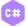</a></td>
   <td align="center"></td>
   <td align="center"></td>
   <td align="center"></td>
   <td align="center"></td>
   <td align="center"></td>
   <td align="center"></td>
   <td align="center"></td>
   <td align="center"></td>
   <td align="center"></td>
  </tr>
  <tr>
   <td align="center"></td>
   <td align="center"></td>
   <td align="center"></td>
   <td align="center"> </td>
   <td align="center"><a href=https://isar.dev/fr/ title="Isar">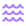</a></td>
   <td align="center"><a href=https://www.adobe.com/products/aftereffects.html title="Adobe After Effects">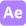</a></td>
   <td align="center"></td>
   <td align="center"></td>
   <td align="center"></td>
   <td align="center"></td>
   <td align="center"></td>
  </tr>
  <tr>
   <td align="center"></td>
   <td align="center"></td>
   <td align="center"></td>
   <td align="center"> </td>
   <td align="center"></td>
   <td align="center"></td>
   <td align="center"></td>
   <td align="center"></td>
   <td align="center"></td>
   <td align="center"></td>
   <td align="center"></td>
  </tr>
  <tr>
   <td align="center"></td>
   <td align="center"></td>
   <td align="center"></td>
   <td align="center"></td>
   <td align="center"></td>
   <td align="center"></td>
   <td align="center"></td>
   <td align="center"></td>
   <td align="center"></td>
   <td align="center"></td>
   <td align="center"></td>
  </tr>
  <tr>
   <td align="center"></td>
   <td align="center"></td>
   <td align="center"></td>
   <td align="center"></td>
   <td align="center"></td>
   <td align="center"></td>
   <td align="center"></td>
   <td align="center"></td>
   <td align="center"></td>
   <td align="center"></td>
   <td align="center"></td>
  </tr>
 </tbody>
</table>

 

### My stats

 
 

